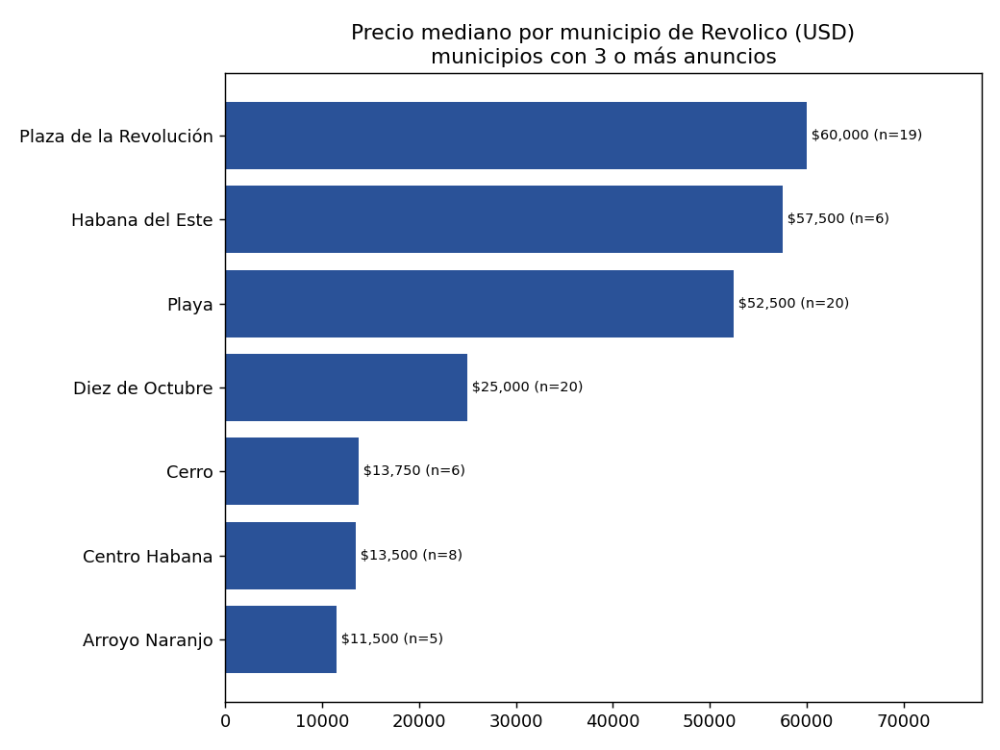
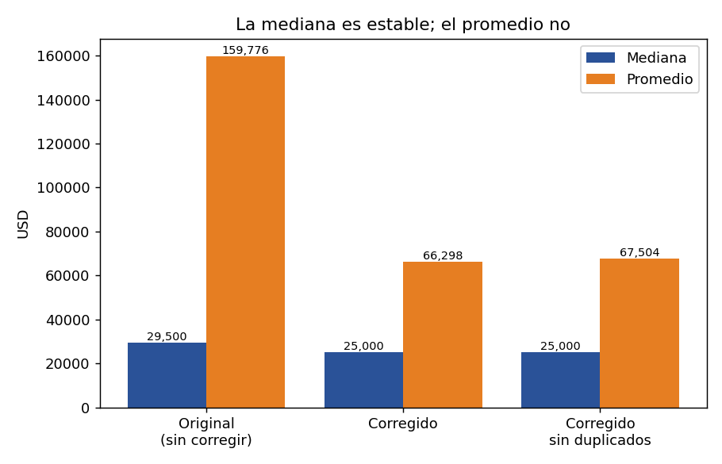
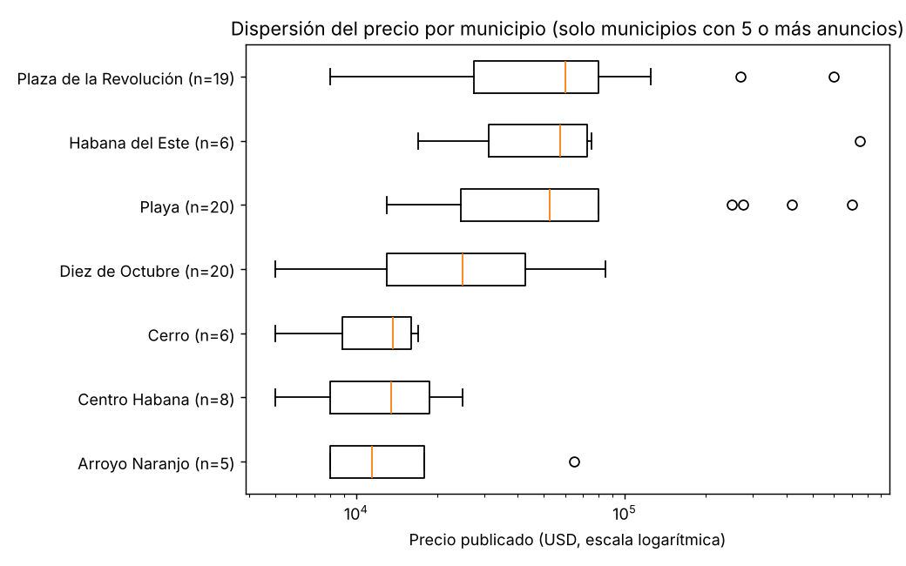
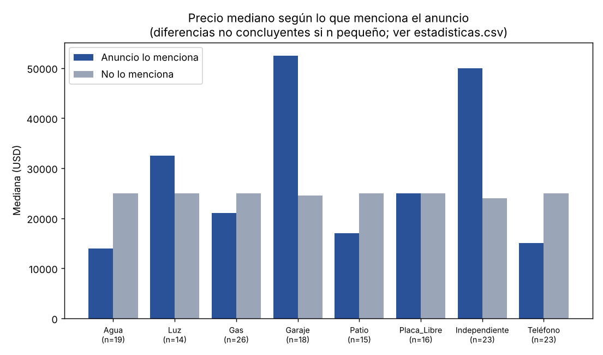
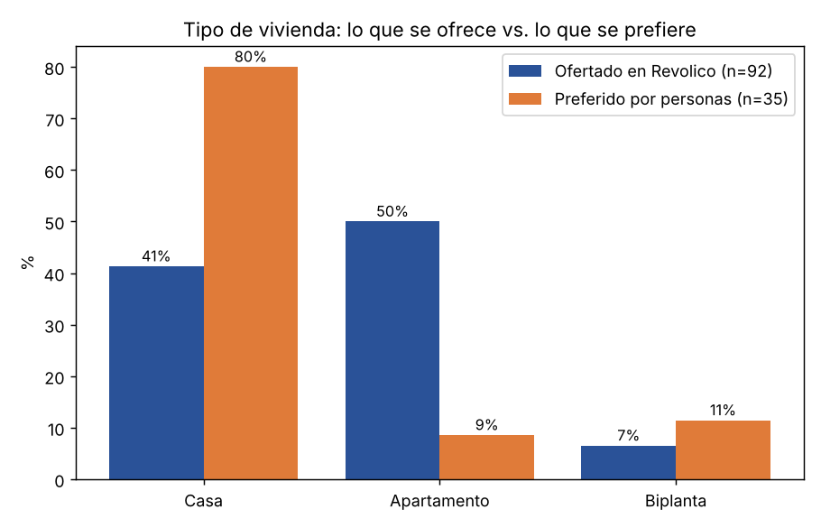
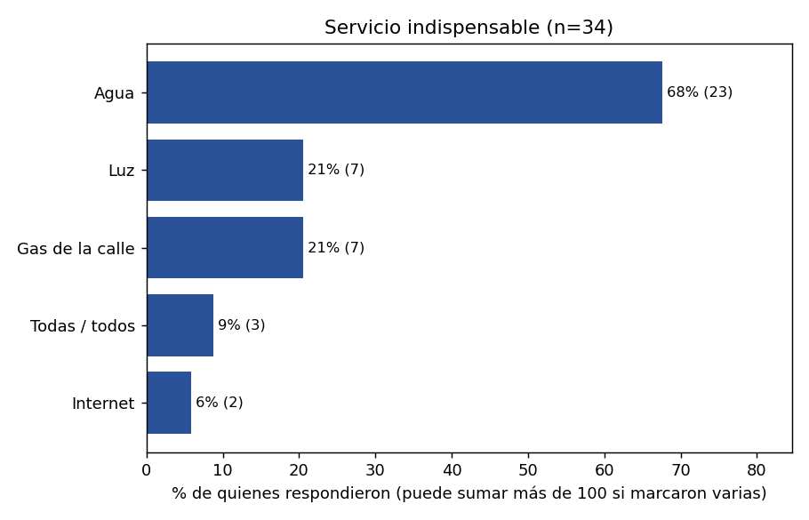
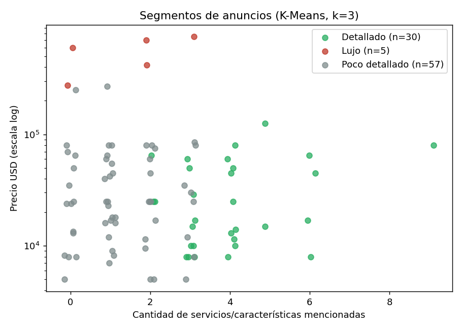

# Análisis del mercado inmobiliario en La Habana
### ¿Qué determina realmente el precio de una vivienda en La Habana?

Proyecto de Introducción a la Ciencia de Datos (Facultad de Matemática y Computación, Universidad de La Habana, ICD 26-27).
**Autora:** Brianet Fagil Cuni.

> **Todo el proyecto se hizo desde un teléfono Android**, con Python en PyDroid 3 (y Termux para comandos y Git), sin computadora y con asistentes de inteligencia artificial como apoyo. Por eso los archivos están todos en la raíz del repositorio y no en carpetas: en esta guía se agrupan por tipo. Las herramientas, los pasos y el cronograma de tres semanas están en el [informe técnico](informe_tecnico.pdf).

## Resumen
El estudio combina tres fuentes: **92 anuncios de venta de Revolico**, **5 inmobiliarias o gestoras** y **35 personas** entrevistadas.

El primer hallazgo es metodológico: el 17% de los precios extraídos automáticamente era erróneo y el promedio inicial (159,776 USD) engañaba. Con los precios corregidos, **la mediana es de 25,000 USD** y la mitad de los anuncios va de 12,000 a 61,250 USD.

El factor más claro del precio es el **barrio**: Plaza de la Revolución, Playa y Habana del Este tienen una mediana de 60,000 USD frente a 15,000 en el resto. Lo que la gente dice valorar (agua diaria, corriente estable) casi no aparece en los anuncios, y la emigración, motivo principal de venta según las inmobiliarias, no la menciona ningún anuncio.

**Conclusión:** los anuncios sirven para ubicar niveles de precio, no para tasar una casa concreta.

## Cómo leer este repositorio
1. Este README, para tener el mapa completo.
2. [`historia.pdf`](historia.pdf) (o [`historia.md`](historia.md)): la narrativa con las 30 preguntas, los gráficos y la conclusión.
3. [`informe_tecnico.pdf`](informe_tecnico.pdf) (o [`informe_tecnico.md`](informe_tecnico.md)): todo lo que se hizo, cómo y con qué herramientas.
4. [`diccionario_datos.md`](diccionario_datos.md) y los archivos `.csv`: los datos y el significado de cada columna.
5. [`bitacora.md`](bitacora.md): el registro del trabajo semana por semana.

## Estado actual en cifras
| Indicador | Valor |
|---|---|
| Anuncios analizados | 92 (más una segunda extracción de 78 como contraste) |
| Precio mediano / rango central | 25,000 USD / 12,000 a 61,250 USD |
| Precios corregidos por errores de extracción | 16 (17%) |
| Zonas caras frente al resto (mediana) | 60,000 contra 15,000 USD |
| Variación del precio explicada por la zona | cerca de 30% (R² ajustado 0.30) |
| Personas entrevistadas | 35 (códigos P01 a P35) |
| Inmobiliarias o gestoras | 5 (códigos INM1 a INM5) |
| Preguntas respondidas en la historia | 30 |
| Gráficos | 25 |
| Pruebas automáticas | 14 |

## Preguntas de investigación
**Principal:** ¿Qué determina realmente el precio de una vivienda en La Habana?

La historia la divide en 30 preguntas, en seis capítulos:
1. **El mercado en general:** precio típico, errores de los datos y fiabilidad de la muestra.
2. **El lugar:** zonas caras y baratas, concentración de la oferta y dispersión dentro de cada municipio.
3. **La casa:** tipo de vivienda, cuartos, baños, patio, terraza y estado.
4. **Los servicios:** qué servicios mencionan los anuncios, si suben el precio y si pesa más la zona o los servicios.
5. **El vendedor y la emigración:** motivos de venta, urgencia y permuta.
6. **Lo publicado frente a lo real y lo que piensa la gente:** rebaja al cerrar, obstáculos legales y cruce entre anuncios, inmobiliarias y personas.

## Guía del repositorio
Los archivos están todos en la raíz y se agrupan por tipo o por prefijo del nombre.

| Grupo | Archivos | Contenido |
|---|---|---|
| **Historia** | [`historia.pdf`](historia.pdf), [`historia.md`](historia.md), [`bitacora.md`](bitacora.md), [`guion.md`](guion.md) | La narrativa completa (motivación, 30 preguntas respondidas con datos y gráficos, análisis final y conclusión), el registro de las tres semanas de trabajo y el guion de la exposición |
| **Informe técnico** | [`informe_tecnico.pdf`](informe_tecnico.pdf), [`informe_tecnico.md`](informe_tecnico.md), [`informe_inmobiliario.html`](informe_inmobiliario.html), [`notebook_analisis.ipynb`](notebook_analisis.ipynb) | Todo el trabajo: datos, metodología, herramientas e IA, cronograma, resultados, discusión, limitaciones y anexos; el informe en HTML y el cuaderno con el proceso paso a paso |
| **Código** | `scraping_revolico.py`, `auditoria.py`, `clustering.py`, `estadisticas.py`, `graficos.py`, `entrevistas_cargar_respuesta.py`, `entrevistas_analisis.py`, `generar_informe.py`, `build_informe.py`, `build_historia.py`, `test_datos.py`, `requirements.txt` | Scraping, auditoría, clustering, estadística, gráficos, entrevistas, informes y pruebas |
| **Datos crudos** | `revolico_completo.csv`, `revolico_casas.csv` | Extracciones de Revolico tal como salieron (teléfonos enmascarados) |
| **Datos limpios y resultados** | `inmuebles_habana_pro.csv`, `inmuebles_auditados.csv`, `con_clusters.csv`, `perfil_clusters.csv`, `triangulacion.csv`, `auditoria_resumen.csv`, `estadisticas.csv`, `estadisticas_municipio.csv`, `estadisticas_modelos.csv`, [`diccionario_datos.md`](diccionario_datos.md) | Datos corregidos y auditados, resultados del análisis y explicación de cada columna |
| **Entrevistas** | `personas.csv`, `inmobiliarias.csv`, `respuestas_cualitativas.csv`, `resumen_muestra.csv`, `resumen_inmobiliarias.csv`, [`tabla_entrevistas.md`](tabla_entrevistas.md), [`cuestionarios.md`](cuestionarios.md), [`catalogo_inmobiliarias.md`](catalogo_inmobiliarias.md), [`claves_entrevistas.md`](claves_entrevistas.md), [`prompt_diseno_guia.md`](prompt_diseno_guia.md), [`prompt_analisis_entrevistas.md`](prompt_analisis_entrevistas.md) | Respuestas anonimizadas, las entrevistas en forma de tabla, cuestionarios, catálogo de inmobiliarias y los prompts de IA |
| **Evidencia** | [`fuentes.md`](fuentes.md), [`anuncios_fotografias.md`](anuncios_fotografias.md), `casa_1_...jpg` a `casa_6_...jpg`, `montaje_6_casas.jpg` | Fuentes de cada dato, enlace al catálogo de la inmobiliaria que lo compartió y fotos de seis anuncios |
| **Gráficos** | `grafico_1_...png` a `grafico_16_...png`, `personas_1_...png` a `personas_5_...png`, `inmob_*.png`, [`indice_graficos.md`](indice_graficos.md) | Los 25 gráficos, con un índice que dice qué muestra cada uno |

## Metodología y decisiones
1. **Un anuncio no es una transacción.** Los precios son de oferta, no de cierre.
2. **Mediana en lugar de promedio.** Siete anuncios de más de 150,000 USD arrastraban el promedio; la mediana casi no cambió al corregir los errores (de 29,500 a 25,000 USD), el promedio sí (de 159,776 a 66,298).
3. **Auditoría y cero imputación.** Se leyó el texto de cada anuncio para corregir 16 precios; los datos que no se indican (cuartos, estado) quedan como no indicados.
4. **Mínimo de 5 anuncios por grupo** para concluir; con menos, solo se informa.
5. **Estadística no paramétrica:** Mann-Whitney, correlación de Spearman e intervalos bootstrap, porque los precios no son normales.
6. **Clustering K-Means exploratorio** (k = 3, implementado con NumPy): separa por nivel de detalle del anuncio, no por tipo de mercado, y no se usa como explicación.
7. **Triangulación** de las tres fuentes y de dos extracciones de Revolico.
8. **Sin causalidad:** todo resultado se redacta como asociación.

## Hallazgos principales
- **El barrio manda.** Las zonas caras (Plaza de la Revolución, Playa y Habana del Este) tienen 60,000 USD de mediana frente a 15,000 en el resto; una variable de zona explica cerca de 30% de la variación del precio, el tipo de vivienda 8% y el número de servicios mencionados casi nada.
- **El garaje y el agua se confunden con la zona.** El garaje parece decisivo (52,500 contra 24,500 USD), pero 12 de los 18 anuncios con garaje están en zonas caras; dentro de ellas la diferencia es pequeña.
- **La paradoja del agua.** 23 de 34 personas piden agua como servicio indispensable, pero los anuncios mencionan más el gas (28%) y el teléfono (25%) que el agua (21%); internet no aparece en ninguno.
- **La emigración invisible.** 0 de 92 anuncios la mencionan; 4 de 5 inmobiliarias la dan como motivo principal de venta.
- **Desajuste entre oferta y demanda.** 80% de las personas prefiere casa independiente; en Revolico solo 41% de los anuncios son casas y 50% apartamentos.
- **El precio publicado no es el de cierre.** Dos inmobiliarias estiman una rebaja de alrededor de 10%.

## Galería de visualizaciones
**Precio mediano por municipio**



**La mediana es estable; el promedio no**



**Dispersión del precio por municipio**



**Precio mediano con y sin cada característica**



**Tipo de vivienda: lo que se ofrece frente a lo que se prefiere**



**Servicio indispensable según las personas**



**Segmentos del clustering**



El resto de los gráficos está descrito en [`indice_graficos.md`](indice_graficos.md).

## Cómo reproducir
Con Python 3 y `pip install -r requirements.txt`, desde la carpeta donde están todos los archivos:
```
python graficos.py
python clustering.py
python auditoria.py
python estadisticas.py
python entrevistas_analisis.py
python generar_informe.py
python build_informe.py
python build_historia.py
python -m unittest test_datos -v
```
El scraping (`scraping_revolico.py`) no se probó en vivo: el sitio puede cambiar y Revolico puede bloquear el acceso. Por eso se conservan los datos extraídos en `revolico_completo.csv` y `revolico_casas.csv`.

## Control de calidad
`test_datos.py` contiene 14 pruebas automáticas (`unittest`) que comprueban que hay 92 anuncios, que la mediana corregida es 25,000 USD, que no hay precios menores a 1,000 USD ni teléfonos reales, que los códigos de las entrevistas son los esperados y que la historia tiene 30 preguntas con todas sus imágenes.

## Herramientas y uso de IA
- **Dispositivo:** teléfono Android, sin computadora.
- **Programación:** Python en PyDroid 3 y Termux; pandas, NumPy, SciPy, matplotlib, requests y ReportLab.
- **Datos:** Revolico, WhatsApp y entrevistas en persona, Google Forms y Google Sheets, y Facebook (fotos de anuncios).
- **Publicación:** GitHub.
- **Inteligencia artificial:** asistentes de IA (entre ellos Claude) como apoyo para organizar el repositorio, escribir y revisar código, calcular estadísticas y redactar documentos. Los prompts están en `prompt_diseno_guia.md` y `prompt_analisis_entrevistas.md`. La definición del problema, la recolección de los anuncios, las entrevistas y la revisión de las cifras son de la autora.

## Ética, privacidad y limitaciones
- **Privacidad.** Muchas personas pidieron que no se publicara su nombre ni su número; esos datos se conservan de forma privada y aquí solo hay códigos (P01 a P35, INM1 a INM5). Los teléfonos de los anuncios están enmascarados (`[tel]`). De las cinco inmobiliarias, solo una compartió su catálogo; las otras cuatro prefirieron no hacerlo y se respetó. Las fotos son de publicaciones públicas y se retiran si la agencia lo pide.
- **Limitaciones.** Muestra pequeña (92 anuncios, una extracción); precios de oferta, no de cierre; entrevistas por conveniencia, con inmobiliarias que tienen interés comercial; muchas comparaciones con grupos pequeños (algunas diferencias "significativas" pueden ser azar); la zona se leyó del texto del anuncio; no hay datos de Facebook ni Telegram; el contexto legal (Ley 187/2026) se tomó de la prensa.

*"En la Ciencia de Datos, los datos no hablan por sí solos: hace falta alguien que los limpie, los cuestione y les dé voz con rigor."*
