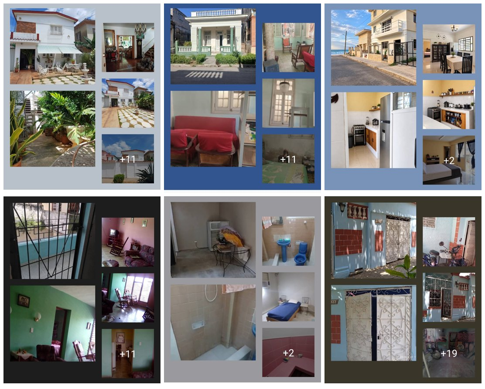

# Evidencia fotográfica de anuncios

Seis capturas de anuncios de venta publicados en Facebook por una inmobiliaria. Cada captura es un collage de fotos del anuncio; el "+11", "+2" o "+19" indica cuántas fotos más tiene la publicación.

**Enlace al catálogo de la inmobiliaria:** https://www.facebook.com/share/1BvYySV94j/

## Por qué es solo una inmobiliaria
Se pidió el catálogo de viviendas a las cinco inmobiliarias. **Solo una lo compartió.** Las otras cuatro prefirieron no hacerlo, y se respetó su decisión para **mantener la privacidad de las inmobiliarias y de las personas**. Del mismo modo, muchas de las personas entrevistadas pidieron que no se publicara su nombre ni su número: esos datos se conservan de forma privada y en el repositorio solo hay códigos (P01 a P35, INM1 a INM5).

## Qué son y qué no son
Son evidencia visual de la variedad de viviendas que se ofertan y de lo que el texto de un anuncio casi nunca describe: el estado, el entorno, los acabados. Las capturas no muestran precio ni dirección, por lo que **no se usan en el análisis estadístico** y no se infiere ningún precio ni ubicación de las fotos.

| Archivo | Lo que se ve |
|---|---|
| `casa_1_patio_dos_plantas.jpg` | Casa de dos plantas con patio de losas, fuente y jardín; sala con escalera interior |
| `casa_2_portal_columnas.jpg` | Casa de una planta con portal de columnas y balaustrada; interior con muebles de balance y cuarto con paredes envejecidas |
| `casa_3_frente_al_mar.jpg` | Casa de dos plantas junto a una calle con el mar al fondo; cocina y comedor modernos, dormitorio con aire acondicionado |
| `casa_4_balcon_interior.jpg` | Vivienda con balcón enrejado, sala y comedor con paredes pintadas, cocina al fondo |
| `casa_5_banos_dormitorio.jpg` | Baños con azulejos y piezas azules, dormitorio sencillo y un local vacío con nevera |
| `casa_6_fachada_azul.jpg` | Casa con fachada azul y paneles de ladrillo, portón de hierro y patio trasero sin terminar |

## Uso en la historia
Estas fotos acompañan la pregunta 15 de la historia (¿el estado de la vivienda se refleja en el precio?): los anuncios casi no dicen nada del estado, pero las fotos muestran que varía mucho de una casa a otra.
