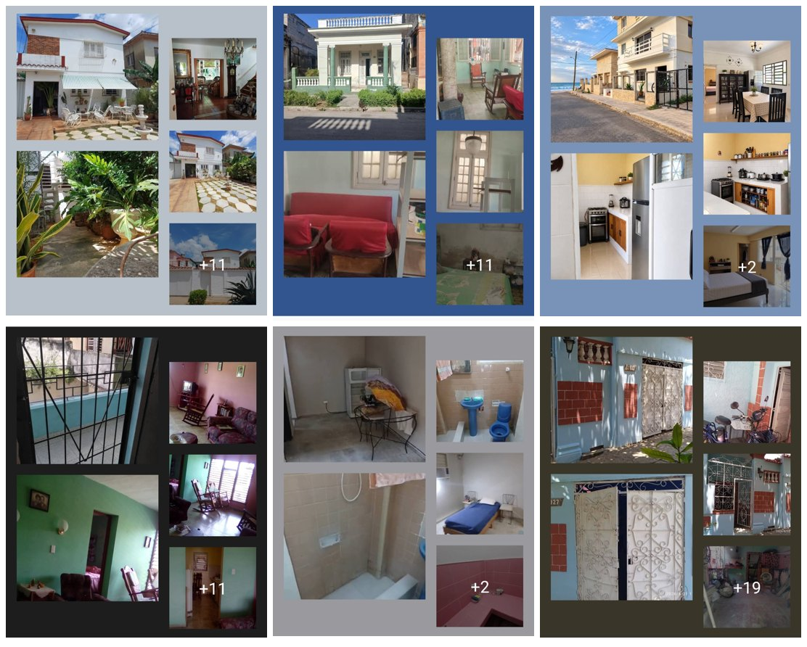
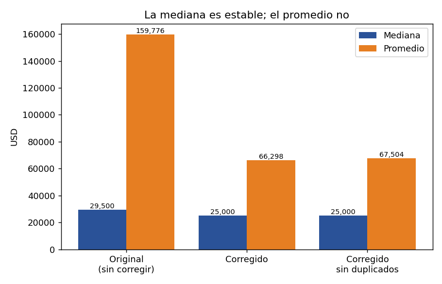
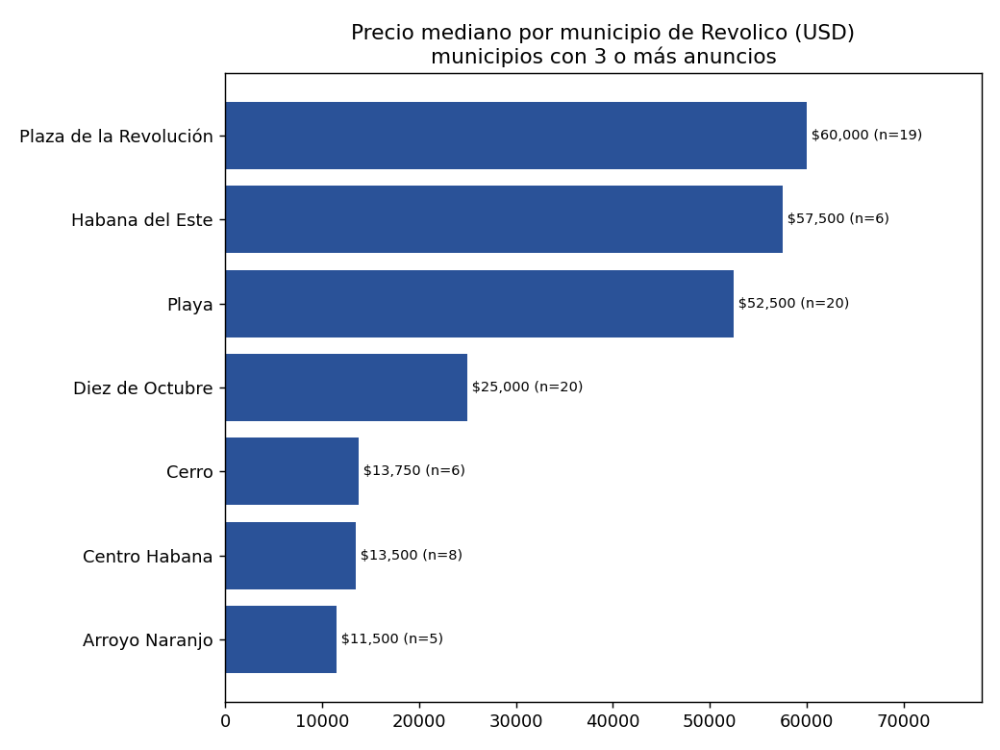
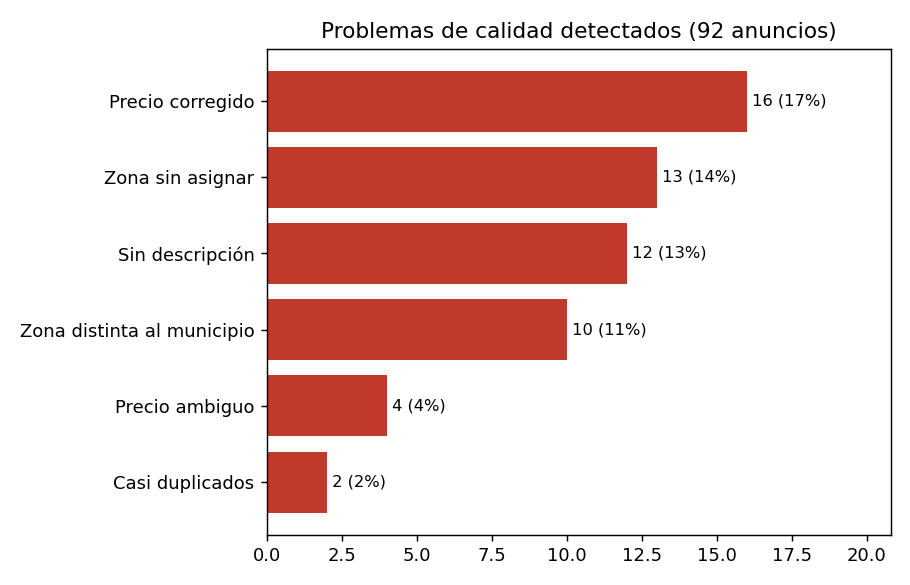
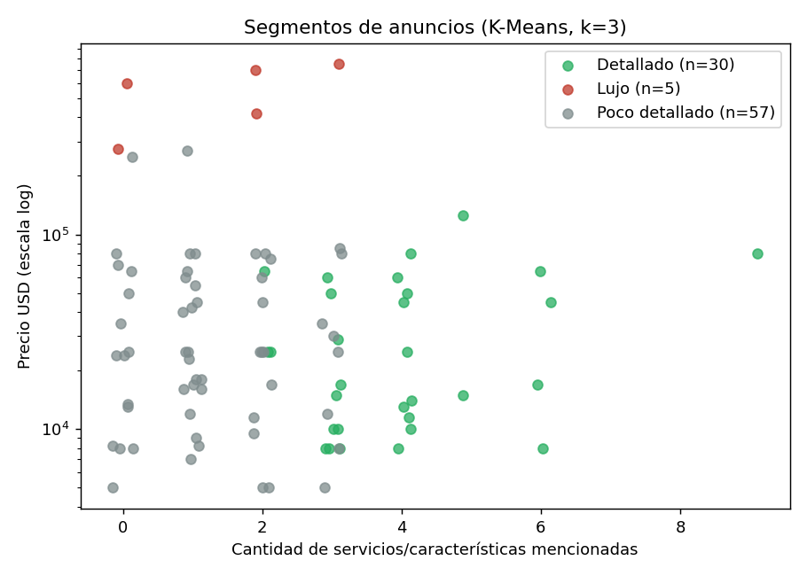
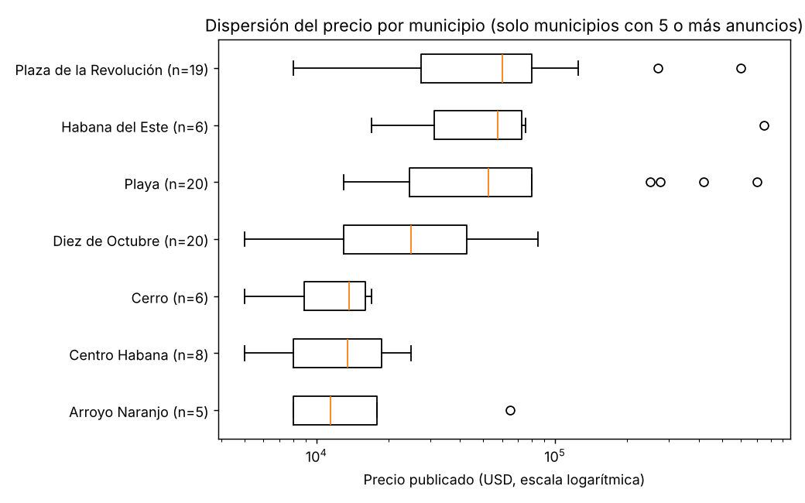
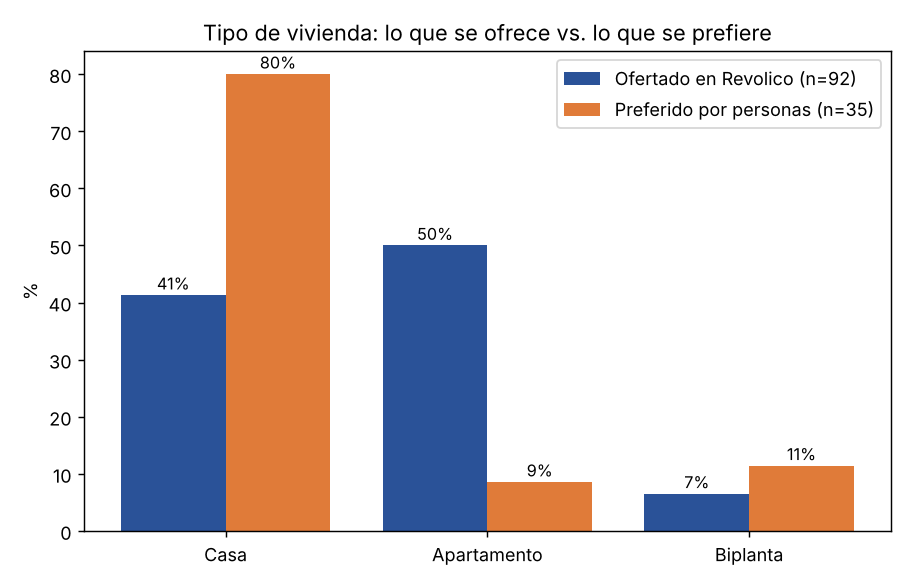
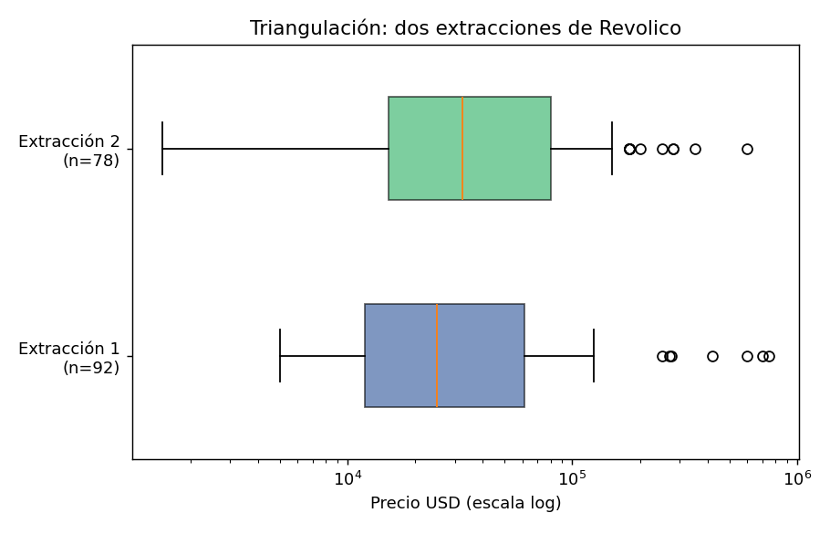

# Informe técnico: el mercado inmobiliario de venta de viviendas en La Habana

**Autora:** Brianet Fagil Cuni. Universidad de La Habana, Facultad de Matemática y Computación, Ciencia de Datos (primer año). Noviembre de 2026.

# Resumen

Este trabajo analiza el mercado de venta de viviendas en La Habana a partir de 92 anuncios de Revolico, una segunda extracción de 78 anuncios válidos y entrevistas a personas e inmobiliarias. El primer hallazgo es metodológico: el 17% de los precios extraídos automáticamente (16 de 92) era erróneo, lo que inflaba el precio promedio de $66,298 a $159,776 USD. Con los precios corregidos, la mediana es de **$25,000 USD**, con la mitad central de los anuncios entre $12,000 y $61,250. Por municipio, los más caros son Plaza de la Revolución, Habana del Este y Playa; los más baratos con 5 o más anuncios, Arroyo Naranjo y Centro Habana.

Se entrevistó a 35 personas y a 5 inmobiliarias o gestoras. El clustering K-Means separa los anuncios sobre todo por su nivel de detalle y aísla un pequeño grupo de casas de lujo. Las entrevistas coinciden con los anuncios en las zonas caras y baratas y señalan una rebaja cercana al 10% entre precio publicado y de cierre. También revelan una contradicción: las inmobiliarias dicen que la emigración es el motivo principal de venta, pero ningún anuncio la menciona.

Durante el estudio se publicó la nueva Ley de la Vivienda (Ley 187/2026), que según la prensa reconoce la actividad inmobiliaria y exige pagos bancarios en la compraventa. Los anuncios analizados son anteriores a la ley.

# 1. Introducción y objetivos

El mercado inmobiliario cubano se ha reactivado en los últimos años, pero casi no existen estadísticas oficiales públicas. Los anuncios en línea y la experiencia de gestores y compradores son hoy las fuentes más accesibles. Este proyecto pregunta: **¿cuánto cuesta una vivienda en La Habana, qué factores influyen y qué tan fiable es lo que muestran los anuncios?**

## Objetivo general

Caracterizar el mercado de venta de viviendas en La Habana combinando datos extraídos de Revolico con entrevistas, y evaluar la calidad de esos datos.

## Objetivos específicos

- Extraer, limpiar y auditar anuncios de venta de viviendas.
- Estimar precios por municipio, tipo de inmueble y servicios, usando estadísticos robustos (mediana).
- Segmentar los anuncios con K-Means y valorar si los grupos tienen sentido de mercado.
- Contrastar los resultados con la opinión de personas e inmobiliarias.

# 2. Datos

## 2.1 Anuncios de Revolico (extracción 1)

Se extrajeron 92 anuncios de venta de casas y apartamentos en La Habana, con título, precio, descripción, servicios mencionados, características y enlace. El municipio de cada anuncio es el que muestra la propia plataforma. Los teléfonos presentes en los textos se enmascararon (*[tel]*) antes de publicar los datos.

## 2.2 Segunda extracción (triangulación)

Una extracción adicional contiene solo título y precio. Tras excluir ofertas de compra, alquileres, gestores y precios menores de 1,000 USD, quedaron 78 anuncios. No es independiente de la primera: puede contener anuncios repetidos.

## 2.3 Entrevistas

Se usaron dos instrumentos. A **personas** que compran o venden vivienda se les aplicó un cuestionario de 5 preguntas de opción múltiple (valor principal al buscar vivienda, zona más cara, tipo preferido, servicio indispensable y percepción de precios). A **inmobiliarias y gestoras** se les envió un cuestionario de 6 preguntas con cifras (zonas, precios de cierre, rebaja, tiempo de venta, servicios, motivos de venta y composición del catálogo) y, con algunas, una versión de 5 preguntas en texto libre. Las entrevistas a personas se realizaron de dos formas: algunas en persona y otras por WhatsApp, con números de contacto obtenidos de anuncios de Revolico y de grupos de compraventa. El muestreo es por conveniencia. Las respuestas son anónimas: se identifican con códigos (P01, INM1) y no se guardan nombres ni teléfonos.

## 2.4 Fuente institucional: Ley de la Vivienda 187/2026

**Contexto legal.** La Ley 187/2026, de la Vivienda, se publicó en la Gaceta Oficial nº 86 el 14 de octubre de 2026 y entra en vigor el 21 de octubre. Sustituye la ley de 1988. Reconoce a las personas naturales hasta dos viviendas en propiedad, además de una de descanso; exige que la compraventa se formalice ante notario; establece que el pago se haga mediante instrumentos bancarios y elimina la confiscación de la vivienda por salida del país (EFE, 14 de octubre de 2026). La compraventa entre particulares estuvo prohibida durante décadas y se autorizó en 2011. Este estudio se hizo en torno a la publicación de la ley: no mide sus efectos.

La extracción de anuncios es anterior a la publicación de la ley (el informe original lleva fecha del 10 de octubre). Algunas entrevistas son posteriores a ella.

## 2.5 Evidencia, catálogos y privacidad

Se pidió el catálogo de viviendas a las cinco inmobiliarias. **Solo una lo compartió**: su enlace de Facebook (https://www.facebook.com/share/1BvYySV94j/) y las capturas de seis de sus anuncios están en *anuncios_fotografias.md* y en los archivos *casa_1_...* a *casa_6_...*. Las otras cuatro prefirieron no compartirlo y se respetó su decisión, para mantener la privacidad de las inmobiliarias. Por eso las cifras de catálogo de las demás agencias son las que dijeron en la entrevista y no una verificación propia.

Muchas de las personas entrevistadas pidieron que no se publicara su nombre ni su número. Esos datos de contacto se conservan de forma privada y no están en el repositorio: solo hay códigos (P01 a P35 e INM1 a INM5) y los teléfonos de los anuncios aparecen enmascarados como [tel]. Las conversaciones originales y las capturas se guardan fuera del repositorio. Las fotos no se usan en las estadísticas; ilustran la variedad de viviendas y lo que un anuncio no describe.

*Figura 1. Seis viviendas de anuncios de una inmobiliaria en Facebook (evidencia visual; no entra en las estadísticas).*

# 3. Metodología

## 3.1 Corrección de precios

La columna de precio numérico del conjunto limpio tenía errores de extracción: dígitos pegados de más (por ejemplo, 560,000 cuando el anuncio decía 60,000) y valores absurdos (de 1 a 170 USD). Para corregirlo se leyó el precio escrito en el texto del anuncio mediante una expresión regular (número seguido de USD) y se descartaron valores menores de 1,000 USD. Se corrigieron 16 de 92 anuncios.

## 3.2 Auditoría de calidad

Se revisaron cuatro problemas: precios corregidos, zona inconsistente con el municipio de Revolico, anuncios sin descripción (solo teléfono) y anuncios casi duplicados (mismo municipio y mismo texto). Cada anuncio recibió una marca por problema, y se evaluó cuánto cambian los resultados al quitarlos.

## 3.3 Estadísticos

Dado que unos pocos anuncios de lujo (hasta 750,000 USD) distorsionan el promedio, el análisis se apoya en la **mediana** y los cuartiles. Los municipios con menos de 3 anuncios no se interpretan.

## 3.4 Clustering

Se aplicó K-Means (implementado con NumPy) sobre cuatro variables estandarizadas: logaritmo del precio, cuartos, baños y cantidad de servicios o características mencionadas. El método del codo sugirió k = 3. Con 20 inicializaciones aleatorias se conservó la de menor inercia.

## 3.5 Tratamiento de las entrevistas

Las respuestas de opción múltiple se codificaron con letras. Cuando una persona marcó varias opciones (por ejemplo, AB) se contó una vez cada opción, y "todas" se codificó aparte. Las preguntas sin respuesta quedan en blanco y cada resultado se calcula sobre quienes respondieron esa pregunta.

## 3.6 Herramientas, entorno de trabajo y uso de inteligencia artificial

**Todo el proyecto se realizó desde un teléfono Android**, sin computadora. Las herramientas fueron:

**Programación y análisis.** Python en **PyDroid 3** (y Termux para comandos y Git), con las bibliotecas pandas, NumPy, SciPy, matplotlib, requests y ReportLab. Con ellas se hicieron el scraping, la limpieza, la auditoría, el clustering, las pruebas estadísticas, los gráficos y los informes en PDF y HTML.

**Recolección de datos.** Revolico (anuncios de venta), WhatsApp y entrevistas en persona (personas e inmobiliarias), Google Forms y Google Sheets (encuesta y registro de respuestas) y Facebook (evidencia fotográfica de anuncios de una inmobiliaria).

**Publicación y control de versiones.** GitHub como repositorio y control de versiones.

**Inteligencia artificial.** Se usaron asistentes de IA (entre ellos Claude) como apoyo para organizar el repositorio, escribir y revisar scripts, calcular las pruebas estadísticas, redactar la historia y este informe, y buscar prensa sobre la Ley de la Vivienda. El prompt usado para diseñar la guía de entrevistas está en *prompt_diseno_guia.md* y el que sirve para analizar las respuestas, en *prompt_analisis_entrevistas.md*. La definición del problema, la recolección de los anuncios, las entrevistas y la revisión de cada cifra son de la autora. Se descartó todo contenido propuesto por la IA que no coincidía con los datos reales.

**Control de calidad.** Catorce pruebas automáticas (*test_datos.py*, con unittest) comprueban que hay 92 anuncios, que la mediana corregida es 25,000 USD, que los precios son válidos, que los códigos de las entrevistas son los esperados, que no hay teléfonos reales en los archivos y que la historia tiene 30 preguntas con todas sus imágenes.

## 3.7 Herramientas y aplicaciones utilizadas

**Tabla 1.** Herramientas, aplicaciones y asistentes de IA usados en el proyecto.

| Herramienta | Para qué se usó |
|---|---|
| Teléfono Android | Único dispositivo de trabajo: programación, entrevistas, redacción y subida al repositorio. No se usó computadora |
| PyDroid 3 | Entorno de Python en el teléfono: scraping, limpieza, auditoría, estadística, clustering, gráficos y generación de PDF |
| Termux | Terminal del teléfono: comandos y Git |
| pandas, NumPy, SciPy | Manejo de datos, cálculo numérico y pruebas estadísticas (Mann-Whitney, Spearman, bootstrap) |
| matplotlib | Gráficos |
| requests | Descarga de páginas para el scraping |
| ReportLab | Generación de los informes en PDF |
| Revolico | Fuente de los anuncios de venta |
| WhatsApp y entrevistas en persona | Contacto con las personas y las inmobiliarias |
| Google Forms y Google Sheets | Encuesta a las personas y registro de respuestas |
| Facebook | Evidencia fotográfica del catálogo de una inmobiliaria |
| GitHub | Repositorio público y control de versiones |
| Asistentes de IA (entre ellos Claude) | Apoyo para organizar el repositorio, escribir y revisar código, calcular estadísticas, redactar y buscar prensa sobre la Ley de la Vivienda. Todas las cifras se verificaron contra los datos |

## 3.8 Cronograma de trabajo (tres semanas)

El proyecto se hizo en tres semanas, entre el 16 de octubre y el 6 de noviembre de 2026. La tabla resume qué se hizo en cada tramo; el detalle y los aprendizajes están en *bitacora.md*.

**Tabla 2.** Cronograma de las tres semanas de trabajo.

| Semana | Días | Tareas | Resultado |
|---|---|---|---|
| 1 (16 al 22 de oct.) | 1 y 2 | Definir la pregunta y el alcance; elegir Revolico; decidir las variables | Pregunta y plan |
| 1 | 3 a 5 | Escribir el scraper en PyDroid 3 y extraer los anuncios; enmascarar teléfonos | 92 anuncios (revolico_completo.csv) |
| 1 | 6 y 7 | Limpieza inicial y primeros gráficos | inmuebles_habana_pro.csv, gráficos 1 a 6 |
| 2 (23 al 29 de oct.) | 1 y 2 | Auditar los precios contra el texto y corregir 16 errores de extracción | inmuebles_auditados.csv, gráficos 11 y 12 |
| 2 | 3 | Segunda extracción y comparación con la primera | triangulacion.csv, gráfico 13 |
| 2 | 4 y 5 | Clustering K-Means con el método del codo (k = 3) | con_clusters.csv, gráficos 7 a 9 |
| 2 | 6 y 7 | Diseñar los cuestionarios y empezar las entrevistas | cuestionarios.md |
| 3 (30 de oct. al 6 de nov.) | 1 y 2 | Terminar, codificar y anonimizar las entrevistas (35 personas y 5 inmobiliarias); pedir los catálogos | personas.csv, inmobiliarias.csv |
| 3 | 3 y 4 | Estadística (Mann-Whitney, Spearman, bootstrap, regresión) y gráficos de comparación y de entrevistas | estadisticas*.csv, gráficos 14 a 16 |
| 3 | 5 | Contexto legal (prensa sobre la Ley 187/2026), fotos y fuentes | fuentes.md, anuncios_fotografias.md |
| 3 | 6 y 7 | Historia con 30 preguntas, informe técnico, diccionario de datos, pruebas, README y guion | historia, informe técnico, test_datos.py |

# 4. Resultados: anuncios de Revolico

## 4.1 Precios

La mediana es de $25,000 USD y el promedio de $66,298. Los anuncios van de $5,000 a $750,000. La Figura 1 muestra por qué el promedio no es fiable: al corregir los errores baja de $159,776 a $66,298, mientras que la mediana casi no se mueve ($29,500 sin corregir, $25,000 corregida, $25,000 sin duplicados).

*Figura 2. La mediana es estable ante las correcciones; el promedio no.*

## 4.2 Precios por municipio

**Tabla 3.** Precio mediano por municipio de Revolico (municipios con 3 o más anuncios).

| Municipio | Mediana (USD) | Anuncios |
|---|---|---|
| Plaza de la Revolución | 60,000 | 19 |
| Habana del Este | 57,500 | 6 |
| Playa | 52,500 | 20 |
| Diez de Octubre | 25,000 | 20 |
| Cerro | 13,750 | 6 |
| Centro Habana | 13,500 | 8 |
| Arroyo Naranjo | 11,500 | 5 |

*Figura 3. Precio mediano por municipio.*

Los municipios más caros son Plaza de la Revolución (que incluye el Vedado), Habana del Este (que incluye Guanabo, zona de playa) y Playa. Diez de Octubre queda en un nivel intermedio y es heterogéneo. Centro Habana, Cerro y Arroyo Naranjo están entre los más baratos.

## 4.3 Tipo de inmueble, servicios y características

**Tabla 4.** Precio mediano por tipo de inmueble (Finca y Otro tienen un solo anuncio).

| Tipo de inmueble | Mediana (USD) | Anuncios |
|---|---|---|
| Finca | 65,000 | 1 |
| Biplanta | 47,500 | 6 |
| Casa | 27,000 | 38 |
| Apartamento | 17,500 | 46 |
| Otro | 8,000 | 1 |

Los servicios más mencionados son el gas de la calle (28% de los anuncios), el teléfono fijo (25%), el agua (21%) y la luz (15%). Ningún anuncio menciona internet. Además, el 58% de los anuncios no indica cuántos cuartos tiene, lo que limita cualquier análisis por tamaño.

## 4.4 Auditoría de datos

**Tabla 5.** Resumen de la auditoría de calidad de los 92 anuncios.

| Indicador | Valor |
|---|---|
| Anuncios analizados | 92 |
| Precios corregidos (el CSV tenía un valor distinto al del anuncio) | 16 |
| Anuncios con más de un precio distinto en el texto | 4 |
| Anuncios con zona distinta al municipio de Revolico | 10 |
| Anuncios con zona sin asignar ('Otra zona') | 13 |
| Anuncios casi duplicados (mismo texto y municipio) | 2 |
| Anuncios sin descripción (solo teléfono) | 12 |
| Precio promedio original (USD) | 159,776 |
| Precio promedio corregido (USD) | 66,298 |
| Precio mediano original (USD) | 29,500 |
| Precio mediano corregido (USD) | 25,000 |
| Precio mediano corregido sin duplicados (USD) | 25,000 |

*Figura 4. Problemas de calidad detectados.*

La zona deducida del texto del anuncio no coincidió con el municipio de Revolico en 10 casos (por ejemplo, anuncios de Guanabo clasificados como Playa) y 13 anuncios quedaron sin zona. Por eso el análisis geográfico se basa en el municipio de la plataforma.

## 4.5 Segmentación con K-Means

**Tabla 6.** Perfil de los tres segmentos (promedios por grupo).

| Segmento | Anuncios | Precio mediano (USD) | Cuartos | Baños | Extras |
|---|---|---|---|---|---|
| Poco detallado | 57 | 25,000 | 0.3 | 0.1 | 1.2 |
| Detallado | 30 | 21,000 | 2.2 | 0.9 | 4.0 |
| Lujo | 5 | 600,000 | 6.4 | 5.6 | 1.4 |

*Figura 5. Segmentos de anuncios según servicios mencionados y precio (escala logarítmica).*

Los grupos no representan tipos de mercado sino, sobre todo, el nivel de detalle del anuncio: el grupo "Poco detallado" casi no informa cuartos ni baños, mientras que "Detallado" sí lo hace. El tercero agrupa cinco casas de lujo (6 o más cuartos, mediana de 600,000 USD). Esto es un resultado útil por sí mismo: advierte que la calidad de la información del anuncio condiciona el análisis.

## 4.6 Triangulación con la segunda extracción

**Tabla 7.** Comparación de estadísticos entre las dos extracciones (USD).

| Fuente | n | P25 | Mediana | P75 | Promedio |
|---|---|---|---|---|---|
| Extracción 1 (92 anuncios, con descripción) | 92 | 12,000 | 25,000 | 61,250 | 66,298 |
| Extracción 2 (solo título y precio) | 78 | 15,250 | 32,500 | 80,000 | 70,733 |

La segunda extracción da una mediana de $32,500 USD, frente a $25,000 de la primera. Coinciden en el orden de magnitud y en la forma de la distribución (Figura 5 del anexo C); la diferencia puede deberse a la composición de anuncios, no a un error de medición.

## 4.7 Pruebas estadísticas

**Tabla 8.** Comparaciones de precio entre grupos (USD). Prueba de Mann-Whitney; con menos de 5 anuncios en un grupo no se concluye.

| Comparación (precio publicado) | n con | n sin | Mediana con | Mediana sin | p (Mann-Whitney) |
|---|---|---|---|---|---|
| Plaza de la Revolución vs resto | 19 | 73 | 60,000 | 24,000 | 0.006 |
| Playa vs resto | 20 | 72 | 52,500 | 24,500 | 0.004 |
| Municipios caros (Plaza, Playa, H. del Este) vs resto | 45 | 47 | 60,000 | 15,000 | 0.000 |
| Centro Habana vs Plaza de la Revolución | 8 | 19 | 13,500 | 60,000 | 0.002 |
| Casa vs resto | 38 | 54 | 27,000 | 24,000 | 0.040 |
| Apartamento vs resto | 46 | 46 | 17,500 | 32,500 | 0.012 |
| Con Agua | 19 | 73 | 14,000 | 25,000 | 0.036 |
| Con Luz | 14 | 78 | 32,500 | 25,000 | 0.811 |
| Con Gas | 26 | 66 | 21,000 | 25,000 | 0.157 |
| Con Teléfono | 23 | 69 | 15,000 | 25,000 | 0.085 |
| Con Internet | 0 | 92 | - | 25,000 | n < 5 |
| Con Garaje | 18 | 74 | 52,500 | 24,500 | 0.007 |
| Con Patio | 15 | 77 | 17,000 | 25,000 | 0.212 |
| Con Terraza | 21 | 71 | 45,000 | 25,000 | 0.292 |
| Con Balcon | 13 | 79 | 25,000 | 25,000 | 0.724 |
| Con Jardín | 6 | 86 | 95,000 | 25,000 | 0.064 |
| Con Piscina | 3 | 89 | 18,000 | 25,000 | n < 5 |
| Con Placa_Libre | 16 | 76 | 25,000 | 25,000 | 0.595 |
| Con Independiente | 23 | 69 | 50,000 | 24,000 | 0.054 |
| Con Amoblado | 9 | 83 | 16,000 | 25,000 | 0.708 |
| Con Negociable | 5 | 87 | 10,000 | 25,000 | 0.224 |
| Con Permuta | 2 | 90 | 45,000 | 25,000 | n < 5 |
| Con Vista_al_mar | 0 | 92 | - | 25,000 | n < 5 |
| Marcado Es_Oportunidad (definición no documentada) | 42 | 50 | 25,000 | 25,000 | 0.287 |

Se hicieron unas 25 comparaciones; con ese número de pruebas se espera que alguna salga "significativa" por azar, así que los p-valores se usan como orientación y no como prueba definitiva. La diferencia entre municipios caros (Plaza de la Revolución, Playa y Habana del Este) y el resto es la más clara: medianas de 60,000 y 15,000 USD. El garaje y el agua parecen asociarse al precio, pero la mayoría de esos anuncios están en zonas caras (garaje) o en zonas baratas (agua), de modo que el efecto se confunde con la zona.

La correlación de Spearman entre el precio y los cuartos es 0.56 (39 anuncios que lo indican) y con los baños 0.61 (24 anuncios). Los anuncios que dicen cuartos y baños son los más detallados, así que no representan a todos.

Un modelo lineal sobre el logaritmo del precio, solo exploratorio, da un R² ajustado de 0.30 con una variable de zona cara, 0.08 con el tipo de vivienda, 0.01 con el número de servicios mencionados y 0.38 con zona y tipo juntos; añadir los servicios no lo mejora (0.37). La variable de zona cara se definió después de ver los resultados, por lo que el 0.30 es optimista. Código: *estadisticas.py*.

*Figura 6. Dispersión del precio por municipio (municipios con 5 o más anuncios).*

*Figura 7. Tipo de vivienda ofertado en Revolico frente al preferido por las personas entrevistadas.*

# 5. Resultados: entrevistas

> **Corte de datos.** Incluyen 35 personas (una de ellas gestora) y 5 inmobiliarias o gestoras. Las muestras son pequeñas y por conveniencia: describen lo que dijeron los entrevistados, no representan a todo el mercado.

## 5.1 Personas

**Tabla 9.** Respuestas de las personas. Una persona puede aportar a más de una opción, por lo que los porcentajes pueden sumar más de 100%.

| Pregunta | Respuesta | Personas | % de quienes respondieron |
|---|---|---|---|
| 1. Qué valora más al buscar vivienda (n=35) | Ubicación | 13 | 37% |
|  | Precio | 2 | 6% |
|  | Servicios básicos | 18 | 51% |
|  | Todas | 4 | 11% |
| 2. Zona más cara (n=33) | Playa | 18 | 55% |
|  | Vedado | 17 | 52% |
| 3. Tipo de inmueble preferido (n=35) | Casa independiente | 28 | 80% |
|  | Apartamento | 3 | 9% |
|  | Biplanta | 4 | 11% |
| 4. Servicio indispensable (n=34) | Agua | 23 | 68% |
|  | Luz | 7 | 21% |
|  | Gas de la calle | 7 | 21% |
|  | Internet | 2 | 6% |
|  | Todos | 3 | 9% |
| 5. Percepción de precios (n=33) | Subiendo | 15 | 45% |
|  | Bajando | 9 | 27% |
|  | Estables | 9 | 27% |

La casa independiente es la preferida de la gran mayoría (28 de 35). Como valor principal al buscar vivienda, los servicios básicos son la opción más elegida (18 de 35), por delante de la ubicación (13), mientras que el precio solo lo eligió 2 personas; otras 4 dicen que todo importa. El agua es el servicio indispensable más citado (23 de 34), seguida del gas (7) y la luz (7). Sobre la zona más cara hay empate técnico entre el Vedado (17 de 33) y Playa (18 de 33). La percepción de precios se inclina hacia que están subiendo (15 de 33), aunque 9 dicen que bajan y 9 que se mantienen.

## 5.2 Inmobiliarias y gestoras

**Tabla 10.** Resumen de las respuestas de inmobiliarias y gestoras (los guiones indican que no respondieron esa pregunta).

| Código | Zonas más caras | Zonas más baratas | Rebaja | Tiempo de venta | Motivo de venta |
|---|---|---|---|---|---|
| INM1 | Playa, Plaza | Centro Habana, Diez de Octubre, Cerro | 5% a 15% | - | Emigración (principal) |
| INM2 | Playa, Diez de Octubre, Plaza | San Miguel del Padrón, Cotorro, Regla | 10% | Más de 12 meses | Emigración y compra de otra vivienda |
| INM3 | - | - | - | - | Irse del país o comprar algo mejor |
| INM4 | - | - | - | - | Reunificación familiar y emigración |
| INM5 | Vedado | - | - | - | - |

Otros datos: INM1 señala que una casa típica en La Habana se cierra entre 18,000 y 30,000 USD, entre 50,000 y 70,000 en Playa y Plaza, y entre 15,000 y 20,000 en Centro Habana, Diez de Octubre y Cerro. INM3 indica un precio promedio de 40,000 a 180,000 USD según el cliente. El catálogo de INM2 tiene 230 viviendas: 150 casas (65%) y 80 apartamentos (35%). INM1 y INM3 coinciden en que la mayoría compra para vivir o para alquilar según el caso, y INM1 añade que la inversión para alquilar se ve poco por límites legales y por la caída del turismo. INM1 cita como problemas documentales frecuentes los títulos desactualizados, las herencias sin declaratoria de herederos y las casas no inscritas en el Registro de la Propiedad.

## 5.3 Las entrevistas en forma de tabla

Las dos tablas siguientes reúnen todas las respuestas, ya decodificadas. Las respuestas están anonimizadas con códigos; los datos de contacto de las personas no se publican.

**Tabla 11.** Inmobiliarias y gestoras: respuestas con cifras (el texto libre de cada una está en el catálogo).

| Código | Zonas caras | Zonas baratas | Cierre caras (USD) | Cierre baratas (USD) | Rebaja % | Meses venta | Servicio valorado |
|---|---|---|---|---|---|---|---|
| INM1 | Playa, Plaza de la Revolución | Centro Habana, Diez de Octubre, Cerro | 60,000 | 17,500 | 10 | - | - |
| INM2 | Playa, Diez de Octubre, Plaza de la Revolución | San Miguel del Padrón, Cotorro, Regla | - | - | 10 | 12 | Corriente |
| INM3 | - | - | - | - | - | - | - |
| INM4 | - | - | - | - | - | - | - |
| INM5 | Vedado | - | - | - | - | - | Agua |

**Tabla 12.** Las 35 personas entrevistadas: una fila por persona.

| Código | Rol | Qué valora más | Zona más cara | Tipo preferido | Servicio indispensable | Precios |
|---|---|---|---|---|---|---|
| P01 | otro | Todas | Playa | Casa | Agua | Estables |
| P02 | gestora | Servicios | Vedado | Casa | Agua | - |
| P03 | otro | Ubicación, Precio | Playa | Casa | Agua | Bajando |
| P04 | otro | Todas | Playa, Vedado | Casa | Agua, Gas | Bajando |
| P05 | otro | Servicios | Playa, Vedado | Casa | Luz | Subiendo |
| P06 | otro | Servicios | Vedado | Casa | Gas | Subiendo |
| P07 | otro | Todas | - | Casa | Todos | Bajando |
| P08 | otro | Ubicación | Vedado | Casa | Agua | Estables |
| P09 | otro | Ubicación | Playa | Casa | Agua | Bajando |
| P10 | otro | Servicios | Playa | Casa | Gas | Estables |
| P11 | otro | Servicios | Vedado | Biplanta | Gas | Subiendo |
| P12 | otro | Ubicación | Playa | Casa | Internet | Bajando |
| P13 | otro | Ubicación | Vedado | Casa | Internet | Bajando |
| P14 | otro | Ubicación | Vedado | Casa | Agua, Luz | Subiendo |
| P15 | otro | Ubicación, Servicios | - | Casa | Todos | Subiendo |
| P16 | otro | Todas | Vedado | Biplanta | Todos | Subiendo |
| P17 | otro | Servicios | Playa | Casa | Agua, Luz, Gas | Subiendo |
| P18 | otro | Ubicación | Vedado | Casa | Agua | Estables |
| P19 | otro | Servicios | Vedado | Casa | Agua, Luz, Gas | Subiendo |
| P20 | otro | Servicios | Playa | Casa | Agua | Subiendo |
| P21 | otro | Servicios | Vedado | Apartamento | Agua | Subiendo |
| P22 | otro | Servicios | Playa | Casa | Agua | Estables |
| P23 | otro | Precio | Playa | Biplanta | Agua | Subiendo |
| P24 | otro | Ubicación | Vedado | Casa | Luz | Subiendo |
| P25 | otro | Ubicación | Playa | Casa | Agua | Estables |
| P26 | otro | Servicios | Playa | Casa | Agua | Estables |
| P27 | otro | Servicios | Playa | Biplanta | Agua | Estables |
| P28 | otro | Servicios | Playa | Casa | Agua | Bajando |
| P29 | otro | Ubicación | Vedado | Casa | Agua | Bajando |
| P30 | otro | Ubicación | Playa | Casa | Agua | Estables |
| P31 | otro | Servicios | Vedado | Casa | Agua, Luz, Gas | Subiendo |
| P32 | otro | Servicios | Vedado | Apartamento | Agua | Bajando |
| P33 | otro | Servicios | Playa | Casa | Agua | Subiendo |
| P34 | otro | Servicios | Playa | Casa | Luz | Subiendo |
| P35 | otro | Ubicación | Vedado | Apartamento | - | - |

# 6. Discusión

- **Zonas.** Las inmobiliarias señalan Playa y Plaza como las más caras, y Centro Habana, Cerro, San Miguel, Cotorro y Regla como las más baratas. Los anuncios lo confirman: Plaza, Playa y Habana del Este (Guanabo) tienen las medianas más altas, y Centro Habana y Cerro, de las más bajas. Diez de Octubre aparece como cara para una inmobiliaria y barata para otra; en los anuncios está en el medio, lo que sugiere que dentro del municipio hay barrios muy distintos (Víbora, Santos Suárez, Luyanó).
- **Precio publicado frente a precio de cierre.** Las inmobiliarias hablan de una rebaja de 5% a 15% (10% como valor típico). Aplicada a la mediana publicada, el precio de cierre estaría cerca de 22,500 USD (estimación ilustrativa, no medida).
- **Motivo de venta.** Cuatro inmobiliarias mencionan la emigración o la reunificación familiar entre los motivos principales, pero ninguno de los 92 anuncios la menciona según la detección por palabras clave. El texto del anuncio no refleja por qué se vende, y por eso no sirve para estudiar ese factor.
- **Servicios.** Las personas eligen los servicios básicos como valor principal (18 de 35) y el agua como el más indispensable (23 de 34); las inmobiliarias hablan de luz estable, agua constante y gas de la calle. En los anuncios el gas es lo más citado, y el agua y la luz se mencionan menos. Se anuncia lo que se puede decir con una palabra; la estabilidad del servicio no suele aparecer.
- **Tiempo de venta.** Una inmobiliaria reporta viviendas sin vender desde hace más de un año, y añade que en Plaza y Playa se venden más rápido. Es un solo dato y debe tomarse como indicio.
- **Marco legal.** Varias respuestas encajan con lo que describe la prensa sobre la Ley 187/2026: INM1 menciona el límite legal de viviendas por persona; INM4 menciona el cheque de gerencia como forma de pago, coherente con la exigencia de pagar por vías bancarias; e INM1 señala como problemas frecuentes los títulos desactualizados y las casas sin inscribir, que se vuelven críticos al exigirse la inscripción registral. Si la ley elimina la confiscación por salida del país, podría cambiar el peso de la emigración como motivo de venta: es una hipótesis para estudios futuros, no un resultado de este trabajo.

# 7. Limitaciones

- Muestra pequeña: 92 anuncios de una sola extracción; varios municipios tienen 1 o 2 anuncios.
- Precios de oferta, no de cierre. El precio de cierre solo se conoce por lo que dicen las inmobiliarias.
- Sesgo de selección: los anuncios y los contactos para las entrevistas provienen de plataformas y grupos en línea, que no representan a todo el mercado.
- Entrevistas por conveniencia, aplicadas en persona y por WhatsApp sin registrar el modo de cada una, lo que puede introducir diferencias; muestras pequeñas; dos versiones del cuestionario para inmobiliarias, por lo que no todas las respuestas son comparables.
- Zona y características extraídas del texto con reglas simples; hay errores y datos faltantes (muchos anuncios no indican cuartos).
- Anuncios duplicados o casi duplicados; la segunda extracción puede compartir anuncios con la primera.
- La Ley 187/2026 entró en vigor el 21 de octubre de 2026: los anuncios son anteriores y parte de las entrevistas se hizo durante o después, por lo que el mercado podría estar cambiando.
- El scraper no se probó en un entorno con acceso continuo a internet.

# 8. Conclusiones

- La calidad de los datos cambia las conclusiones: sin corregir los precios, el promedio parecía de $159,776 USD; corregido, es de $66,298 y la mediana de $25,000.
- La mediana es el estadístico adecuado en este mercado por la presencia de pocos anuncios de lujo y de errores de extracción.
- Plaza de la Revolución, Habana del Este (Guanabo) y Playa son las zonas más caras, con medianas de 52,000 a 60,000 USD; Centro Habana, Cerro y Arroyo Naranjo, de 11,000 a 14,000.
- Anuncios, personas e inmobiliarias coinciden en el mapa de zonas caras y baratas, y en el peso de los servicios básicos y la casa independiente.
- Los anuncios no recogen el motivo de venta ni la estabilidad de los servicios, dos factores que las entrevistas señalan como centrales.
- El clustering con las variables disponibles separa la calidad de la información, no segmentos de mercado.
- El marco legal cambió durante el estudio (Ley 187/2026): el pago bancario, la inscripción registral y el límite de viviendas pueden afectar precios y plazos, y justifican repetir la medición.

## Trabajo futuro

- Ampliar a más extracciones en distintas fechas para medir cambios en el tiempo.
- Completar las entrevistas y recoger precios de cierre reales.
- Incorporar otra fuente en línea (por ejemplo, grupos de Facebook) y comparar.

# Anexo A. Cuestionarios

## Personas

1. Qué valora más al buscar vivienda: A) ubicación, B) precio, C) servicios básicos (agua, luz, gas), D) espacio. 2. Zona de La Habana que considera más cara: A) Playa, B) Vedado, C) Centro Habana, D) otra. 3. Tipo de inmueble preferido: A) casa independiente, B) apartamento, C) biplanta. 4. Servicio básico indispensable: A) agua, B) luz, C) gas de la calle, D) internet. 5. Percepción de los precios: A) subiendo, B) bajando, C) estables.

## Inmobiliarias (6 preguntas)

1. Zonas más caras y más económicas y precio promedio real de cierre. 2. Porcentaje de rebaja del precio publicado al de cierre. 3. Tiempo promedio de venta en meses. 4. Servicio básico más valorado y aumento aproximado del valor. 5. Motivo de venta: emigración, necesidad de dinero o mudanza (porcentajes). 6. Composición del catálogo: casas, apartamentos y otros (porcentajes).

# Anexo B. Estructura del repositorio

El repositorio contiene los datos crudos y limpios (*datos_**), los gráficos (*grafico_**), los scripts de scraping, limpieza, clustering, auditoría y generación del informe (**), un cuaderno con el proceso completo (*notebook_analisis.ipynb*), el diccionario de datos (*diccionario_datos.md*), las pruebas automáticas (**), la evidencia (**, con fuentes y fotos de anuncios), el informe en HTML y las entrevistas anonimizadas con su catálogo y cuestionarios (**). El README explica el orden para reproducir los resultados.

# Anexo C. Figura complementaria

*Figura 8. Distribución de precios en las dos extracciones de Revolico (escala logarítmica).*

# Anexo E. Fuentes consultadas

EFE, "Cuba publica nueva Ley de Vivienda que permite tener hasta dos inmuebles en propiedad", 14 de octubre de 2026 (Infobae, Swissinfo y Diario Libre).

Escambray, "Cuba publica una nueva Ley de la Vivienda: ¿qué cambia?", octubre de 2026.

Periódico Cubano, "Adiós al efectivo: nueva Ley de Vivienda en Cuba cambia las reglas de la compraventa", octubre de 2026.

Directorio Cubano, "Cuba publica una nueva Ley de la Vivienda: estos son los cambios para los propietarios", 14 de octubre de 2026.

La República, "Cuba autoriza compraventa de casas", 4 de noviembre de 2011 (EFE).

Nota: son fuentes de prensa. El texto oficial está en la Gaceta Oficial de la República de Cuba, edición ordinaria nº 86 (14 de octubre de 2026).

# Anexo D. Procedimiento paso a paso

El proceso se hizo en el orden siguiente. Cada paso indica el código que lo ejecuta y los archivos que produce, para que se pueda revisar y reproducir.

**1. Recolección de anuncios.** Se extrajeron 92 anuncios de venta de Revolico con *scraping_revolico.py*. Resultado: *revolico_completo.csv*. Los teléfonos se enmascararon como [tel] antes de publicar.

**2. Segunda extracción.** Una extracción de solo título y precio (*revolico_casas.csv*). Se excluyeron ofertas de compra, alquileres, gestores y precios menores de 1,000 USD, y quedaron 78 anuncios.

**3. Corrección de precios.** El precio numérico original tenía errores. Se leyó el precio escrito en el texto de cada anuncio. Resultado: 16 precios corregidos (*inmuebles_auditados.csv*).

**4. Auditoría de calidad.** Se revisaron la zona frente al municipio de Revolico, los anuncios sin descripción, los casi duplicados y las zonas sin asignar. Código: *auditoria.py*. Resumen: *auditoria_resumen.csv*.

**5. Estadística descriptiva.** Se calcularon medianas, cuartiles y promedios por municipio y tipo de inmueble. Gráficos 1 a 6 con *graficos.py*. La sensibilidad de la mediana y el promedio está en el gráfico 12. Las pruebas estadísticas (Mann-Whitney, Spearman, regresión sobre el logaritmo del precio) están en *estadisticas.py* y sus resultados en *estadisticas.csv*.

**6. Clustering.** K-Means implementado con NumPy, con cuatro variables estandarizadas. El método del codo sugirió k = 3, con 20 inicializaciones. Código: *clustering.py*. Resultados: *con_clusters.csv* y *perfil_clusters.csv*.

**7. Entrevistas a personas.** Cuestionario de 5 preguntas, codificado con letras. Se cargaron con *entrevistas_cargar_respuesta.py* en *personas.csv* (35 personas). El análisis, con *entrevistas_analisis.py*, produce los gráficos de **.

**8. Entrevistas a inmobiliarias y gestoras.** Datos numéricos en *inmobiliarias.csv*, respuestas de texto libre en *respuestas_cualitativas.csv*. Cuando una respuesta era un rango, se usó el punto medio y se anotó en la columna de notas.

**9. Triangulación.** Comparación entre las dos extracciones (*triangulacion.csv*, gráfico 13). Las dos muestras no son independientes.

**10. Integración.** Se contrastaron los anuncios, las personas y las inmobiliarias. Los hallazgos están en la historia (*historia.md*).

**11. Informes.** *generar_informe.py* produce *informe_inmobiliario.html*. *build_informe.py* produce este informe, y *build_historia.py* produce la historia en PDF.

**12. Verificación.** Se comprobó que no hay teléfonos en los archivos publicados, que cada cifra del texto sale de un archivo de datos, y que los scripts se ejecutan desde la raíz del repositorio en el orden indicado en el README.
